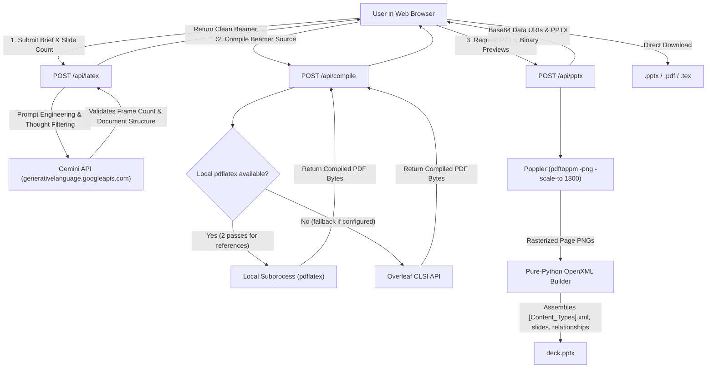

# Python Beamer Deck Maker

A modular, zero-pip-dependency local web application that converts presentation briefs into professional PowerPoint presentations via Gemini AI, LaTeX Beamer, and Poppler.

```
Presentation Brief ──▶ Gemini AI ──▶ Beamer LaTeX (.tex) ──▶ pdflatex / CLSI ──▶ PDF
                                                                                  │
Download (.pptx, .pdf, .tex) ◀── OpenXML PPTX Builder ◀── Poppler (pdftoppm) ◀────┘
```

The backend is built strictly using **Python's standard library** (`http.server`, `urllib`, `subprocess`, `zipfile`). The frontend is built with vanilla HTML5, CSS3, and modern JavaScript—requiring **no Node.js, npm, or build tools**.

---

## Table of Contents

- [How It Works](#how-it-works)
  - [Workflow Diagram](#workflow-diagram)
  - [Pipeline Breakdown](#pipeline-breakdown)
- [Project Architecture & Modular Structure](#project-architecture--modular-structure)
- [Requirements & Prerequisites](#requirements--prerequisites)
  - [Runtime Requirements](#runtime-requirements)
  - [System Binaries by Operating System](#system-binaries-by-operating-system)
- [Quickstart & Installation](#quickstart--installation)
- [Configuration](#configuration)
- [HTTP API Reference](#http-api-reference)
- [Testing & Verification](#testing--verification)

---

## How It Works

### Workflow Diagram



### Pipeline Breakdown

1. **AI Generation (`deck_maker.generator`)**:
   - Takes a prompt brief (1–4,000 characters) and a requested slide count (3–12 slides).
   - Prompts the Gemini model using strict instructions: 16:9 aspect ratio (`\documentclass[aspectratio=169]{beamer}`), explicit `\begin{frame}` blocks, escaping special characters, and omitting external image dependencies.
   - Filters out internal thought parts (`part.get('thought')`) and markdown code blocks.
   - Automatically counts generated frames; if the frame count does not match the target count, it retries once with explicit adjustment instructions.
   - Automatically retries transient provider errors (HTTP 500, 502, 503, 504) with backoff.

2. **LaTeX Validation & Compilation (`deck_maker.compiler`)**:
   - Sanitizes and validates the incoming LaTeX source (enforcing document length <= 64 KB and required Beamer structure).
   - Executes `pdflatex` locally in an isolated temporary directory with `-no-shell-escape`, `-halt-on-error`, and `-interaction=nonstopmode`.
   - Runs **two compilation passes** so that Beamer page counters, navigation symbols, and cross-references resolve accurately.
   - If compilation fails, parses `main.log` to present a concise, actionable error excerpt back to the user.
   - Supports fallback compilation via a private Overleaf CLSI endpoint if local TeX is unavailable.

3. **PDF Rasterization & Preview Generation (`deck_maker.converter`)**:
   - Uses Poppler's `pdftoppm` utility to render each PDF page into high-resolution PNG images at up to 1,800 pixels on the longest side.
   - Converts each slide into a Base64 `data:image/png;base64,...` URI for instant slide-by-slide navigation in the browser.

4. **Pure-Python PowerPoint Assembly (`deck_maker.pptx_builder`)**:
   - Does **not** require `python-pptx` or any C-extension packages.
   - Builds a compliant ECMA-376 OpenXML PowerPoint (`.pptx`) ZIP package entirely in memory using Python's standard `zipfile` module.
   - Dynamically calculates slide dimensions in EMUs (English Metric Units) to prevent image distortion, perfectly centering slides across widescreen (16:9) and standard aspect ratios.

5. **Local Web Interface (`deck_maker.server` & `public/`)**:
   - Serves an interactive three-step workflow (Brief -> Source Editor -> Interactive Preview & Export).
   - Provides features to:
     - **Load example**: Test a 3-slide sample without needing an API key.
     - **Import PDF**: Convert any existing unencrypted PDF (up to 15 MB / 30 pages) into a PowerPoint presentation.
     - **Open in Overleaf**: One-click form submission into Overleaf's web editor.

---

## Project Architecture & Modular Structure

The project is structured into a clean, decoupled Python package (`deck_maker`), fronted by an entry-point script (`app.py`):

```
deck/
├── app.py                      # Main entrypoint CLI and backwards-compatible facade
├── requirements.txt            # Python & system dependency documentation
├── README.md                   # Comprehensive documentation
├── .env.example                # Template for environment configuration
├── .env                        # Local configuration (API keys, ports, paths)
│
├── deck_maker/                 # Core modular package
│   ├── __init__.py             # Exports public API
│   ├── __main__.py             # CLI runner: python -m deck_maker
│   ├── config.py               # Settings, environment loader & tool auto-discovery
│   ├── exceptions.py           # Domain exceptions (AppError)
│   ├── generator.py            # Gemini AI Beamer generation & frame retry logic
│   ├── compiler.py             # LaTeX validation, pdflatex subprocess & CLSI
│   ├── pptx_builder.py         # Pure-Python OpenXML PPTX generation from PNGs
│   ├── converter.py            # Poppler rasterization & preview conversion
│   └── server.py               # HTTP request routing, security headers & concurrency locks
│
├── public/                     # Static web frontend
│   ├── index.html              # Clean single-page application markup
│   ├── app.css                 # Responsive stylesheet
│   ├── app.js                  # Asynchronous client controller
│   └── sample.tex              # Default 3-slide Beamer template
│
└── tests/                      # Modular unit test suite
    ├── __init__.py
    ├── test_config.py          # Configuration and path resolution tests
    ├── test_compiler.py        # LaTeX sanitization and error log parsing tests
    ├── test_generator.py       # Prompt validation and frame count retry tests
    ├── test_pptx.py            # OpenXML PPTX structure and dimension tests
    ├── test_converter.py       # PDF validation tests
    └── test_server.py          # HTTP routing and security tests
```

---

## Requirements & Prerequisites

### Runtime Requirements
- **Python >= 3.10**
- **Zero Python pip dependencies**: The application uses only Python standard library modules (`http.server`, `urllib`, `subprocess`, `json`, `zipfile`, etc.).

### System Binaries by Operating System

To compile LaTeX and render previews to PowerPoint, install `pdflatex` and `pdftoppm`:

#### macOS
```bash
# TeX distribution (pdflatex)
brew install --cask mactex-no-gui
# Alternatively, for a lighter install:
# brew install basictex && sudo tlmgr install beamer

# Poppler (pdftoppm)
brew install poppler
```

#### Ubuntu / Debian Linux
```bash
sudo apt update
sudo apt install -y texlive-latex-recommended texlive-latex-extra poppler-utils
```

#### Windows
1. **LaTeX (MiKTeX)**: Install via [miktex.org](https://miktex.org) or via winget:
   ```powershell
   winget install MiKTeX.MiKTeX
   ```
   *(Ensure "Always install missing packages on the fly" is enabled in MiKTeX settings).*
2. **Poppler**: Install via Scoop (`scoop install poppler`) or Chocolatey (`choco install poppler`), or extract a binary release and set `PDFTOPPM_PATH` in `.env`.

---

## Quickstart & Installation

1. **Clone or navigate to the workspace**:
   ```bash
   cd deck
   ```

2. **Configure your environment**:
   ```bash
   # Create .env from the template if it does not already exist
   cp .env.example .env
   ```
   Open `.env` and configure your `GEMINI_API_KEY`:
   ```dotenv
   PORT=3000
   GEMINI_API_KEY=your_gemini_api_key_here
   GEMINI_MODEL=gemini-3.5-flash-lite
   LATEX_COMMAND=pdflatex
   LATEX_TIMEOUT_MS=180000
   PDFTOPPM_PATH=
   OVERLEAF_CLSI_URL=
   ```

3. **Check tool availability**:
   Verify that your LaTeX compiler, Poppler renderer, and Gemini API key are detected:
   ```bash
   python app.py --check
   # Or using the package runner:
   python -m deck_maker --check
   ```
   Expected output:
   ```json
   {
     "generate": true,
     "compile": true,
     "render": true,
     "model": "gemini-3.5-flash-lite",
     "compiler": "/Library/TeX/texbin/pdflatex",
     "renderer": "/opt/homebrew/bin/pdftoppm",
     "clsi": false
   }
   ```

4. **Start the application**:
   ```bash
   python app.py
   # Or specify a custom port:
   python app.py --port 3000
   ```

5. **Open in browser**:
   Navigate to [http://127.0.0.1:3000](http://127.0.0.1:3000).

---

## Configuration

| Environment Variable | Default | Description |
|---|---|---|
| `PORT` | `3000` | Local HTTP port to bind to (localhost only). |
| `GEMINI_API_KEY` | *(empty)* | Google Gemini API key. Required only for AI slide generation. |
| `GEMINI_MODEL` | `gemini-3.5-flash-lite` | Gemini model identifier used for Beamer generation. |
| `LATEX_COMMAND` | `pdflatex` | Executable name or full path to `pdflatex`. Automatically discovers macOS, Linux, and Windows paths if unset. |
| `LATEX_TIMEOUT_MS` | `180000` | Timeout budget for both compilation passes in milliseconds (10,000–600,000). |
| `PDFTOPPM_PATH` | *(empty)* | Full path to `pdftoppm` binary, or blank for automatic PATH and system discovery. |
| `OVERLEAF_CLSI_URL`| *(empty)* | Optional private Overleaf CLSI compilation service URL (used when no local compiler exists). |

---

## HTTP API Reference

The service binds exclusively to `127.0.0.1` and enforces strict security headers (`Content-Security-Policy`, `Cache-Control: no-store`, and cross-origin POST blocking).

### `GET /api/config`
Returns system status and capabilities without exposing sensitive credentials.
- **Response `200 OK`**:
  ```json
  {
    "generate": true,
    "compile": true,
    "render": true,
    "model": "gemini-3.5-flash-lite",
    "compiler": "/usr/bin/pdflatex",
    "renderer": "/usr/bin/pdftoppm",
    "clsi": false
  }
  ```

### `POST /api/latex`
Generates Beamer LaTeX from a text brief.
- **Request Headers**: `Content-Type: application/json`
- **Request Body**:
  ```json
  {
    "brief": "Explain the water cycle to middle school students.",
    "slideCount": 4
  }
  ```
- **Response `200 OK`**:
  ```json
  {
    "latex": "\\documentclass[aspectratio=169]{beamer}..."
  }
  ```

### `POST /api/compile`
Compiles Beamer LaTeX source code into a PDF.
- **Request Headers**: `Content-Type: application/json`
- **Request Body**:
  ```json
  {
    "latex": "\\documentclass[aspectratio=169]{beamer}\\begin{document}\\begin{frame}{Title}\\end{frame}\\end{document}"
  }
  ```
- **Response `200 OK`**: Raw PDF bytes (`Content-Type: application/pdf`).
- **Response `422 Unprocessable Entity`**: Compilation failure with compiler log excerpt.
- **Response `429 Too Many Requests`**: Another compilation is currently running.

### `POST /api/pptx`
Renders a PDF into slide images and generates a PowerPoint presentation.
- **Request Headers**: `Content-Type: application/pdf`
- **Request Body**: Raw PDF bytes (up to 15 MB, max 30 pages).
- **Responses**:
  - When header `Accept: application/json` is sent:
    ```json
    {
      "slides": [
        "data:image/png;base64,iVBORw0KGgo...",
        "data:image/png;base64,iVBORw0KGgo..."
      ],
      "pptx": "UEsDBBQAAAAIA..."
    }
    ```
  - Default / binary download:
    Returns raw `.pptx` bytes with header `Content-Disposition: attachment; filename="deck.pptx"`.

---

## Testing & Verification

Run the comprehensive unit test suite:

```bash
# Run all tests (both legacy and new modular suites)
python -m unittest discover -v

# Run modular unit tests specifically
python -m unittest discover -s tests -v

# Run legacy regression suite
python test_app.py
```

### End-to-End Workflow Verification
The included `verify_workflow.py` script validates the end-to-end HTTP pipeline by starting an ephemeral in-process server, testing compilation, preview extraction, and OpenXML relationship integrity:

```bash
# Verify using local sample template
python verify_workflow.py

# Verify using live Gemini API call
python verify_workflow.py --gemini
```
Artifacts from verification tests are saved into `output/sample/` or `output/gemini/`.
